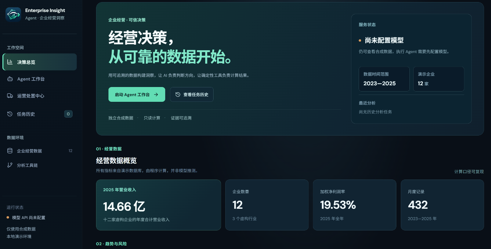
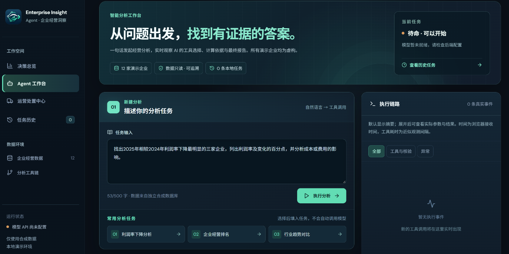
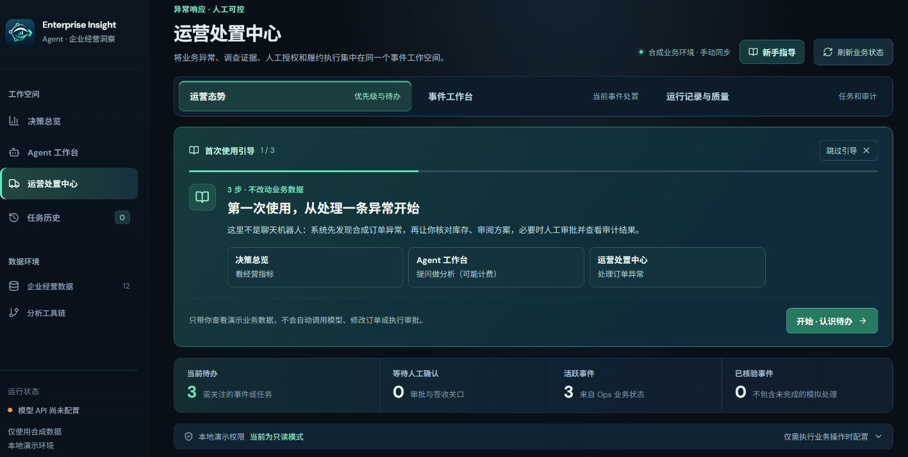
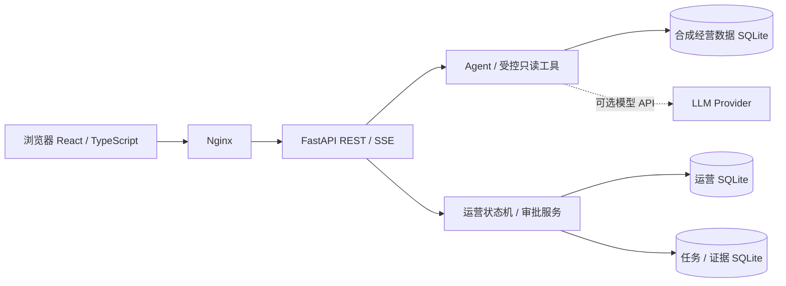

# Enterprise Insight Agent


**面向企业经营分析与运营处置的 AI Agent 全栈演示系统**  
*Evidence-backed analytics · Human-approved operations · Local-first deployment*

Enterprise Insight Agent 将经营数据分析、AI 辅助调查与受控业务执行整合在同一个工作空间中。系统使用**自生成合成数据**，展示从指标洞察、异常识别、调查取证、方案审批到模拟履约和故障恢复的完整过程。

> 这是可本地运行的个人技术作品，**不是生产 SaaS**。不连接真实企业订单、仓储或物流系统；不含生产身份认证，也不应直接暴露于公网。

## 产品界面 · 本地实机截图

以下图片截取自本地浏览器运行的 **Enterprise Insight Agent**，均使用项目生成的合成演示数据。页面截图展示的是产品界面，并非真实企业运营记录或已完成的模型执行结果。

### 经营决策总览



可查看 12 家虚构企业在 2023—2025 年的经营数据、年度关键指标、趋势图表与快捷分析入口。

### Agent 工作台与运营处置中心

| Agent 工作台 · 分析任务输入（模型未配置） | 运营处置中心 · 首次使用引导 |
| :---: | :---: |
| [](docs/screenshots/agent-workspace-idle.png) | [](docs/screenshots/operations-first-use.png) |

Agent 截图处于**未配置模型的待命状态**，不代表已执行真实 AI 调用；运营截图展示的是**首次使用引导**，不是完成审批或模拟履约后的处理结果。完整的操作步骤见 [本地演示指南](docs/DEMO_GUIDE.md)。

## 核心功能

| 工作空间 | 可以体验什么 | 主要实现 |
|---|---|---|
| **经营决策总览** | 营收、利润率、行业比较、年度趋势与快捷分析入口 | React、ECharts、FastAPI、SQLite |
| **Agent 工作台** | 自然语言问题、工具调用轨迹、只读 SQL、证据分析与报告导出 | LangChain / LangGraph、SSE、受限工具执行 |
| **运营处置中心** | 异常事件队列、调查、库存策略、方案审批与业务状态跟踪 | 领域状态机、审计证据、SQLite 事务 |
| **模拟履约与恢复** | 两级人工操作关口、模拟发运、人工确认签收与断点恢复 | 幂等键、快照核验、持久化回执 |
| **三场景独立演示** | 正常解决、审批拒绝、发运后中断恢复 | 单独数据库与 Compose 沙箱 |

### 设计原则

- **AI 负责分析，确定性服务负责执行：** 模型不直接持有库存与订单写权限。
- **执行必须通过业务关口：** 库存预留与后续模拟履约由独立审批与状态检查控制。
- **每一步有证据：** 记录任务、策略依据、业务回执和异常恢复状态。
- **不将模拟等同生产：** 运营数据、企业、仓库、订单与运单均为虚构，权限机制仅供本地演示。

## 技术架构



**技术栈：** Python、FastAPI、LangChain、LangGraph、SQLite、React、TypeScript、Vite、ECharts、Docker Compose、pytest、GitHub Actions。

## 快速启动

前置条件：Docker Desktop + WSL2（或兼容 Docker Compose 的本地 Linux 环境）。服务仅绑定 `127.0.0.1`。

在项目根目录运行：

```bash
cp -n backend/.env.example backend/.env
docker compose config -q
docker compose up -d --build --wait
python3 scripts/smoke_local_docker.py
```

打开 **http://localhost:8080**。未配置模型密钥时，仍可浏览合成经营数据与只读运营信息，但**不能执行真实 AI 推理任务**。

已经有其他本地项目占用 8080 时：

```bash
EIA_WEB_PORT=18080 docker compose -p eia-portfolio -f compose.yaml up -d --build --wait
python3 scripts/verify_visual_deployment.py --base-url http://127.0.0.1:18080
python3 scripts/smoke_local_docker.py --base-url http://127.0.0.1:18080
```

此时访问 **http://localhost:18080**。如需运行 Agent，请在**本地** `backend/.env` 内配置 `OPENAI_API_KEY`、`OPENAI_MODEL`，必要时设置 `OPENAI_BASE_URL`；调用第三方模型可能产生费用。不要提交真实密钥。

### 独立的三场景操作演示

无需模型 API Key，演示环境与主服务的数据卷相互隔离：

```bash
mkdir -p .demo_runs
export EIA_DEMO_RUN_DIR="$PWD/.demo_runs/demo-$(date +%Y%m%d-%H%M%S)"
(cd backend && uv run --locked python ../scripts/create_p2_demo.py --output "$EIA_DEMO_RUN_DIR")
export EIA_DEMO_WRITE_TOKEN="$(python3 -c 'import secrets; print(secrets.token_urlsafe(32))')"
docker compose -p eia-portfolio-demo -f compose.demo.yaml up -d --build --wait
```

打开 **http://localhost:8081**，进入“运营处置中心”。只读浏览无需令牌；审批等模拟写入需要在本地填写本次生成的演示令牌。详见 [演示操作指南](docs/DEMO_GUIDE.md)。**不要在视频或截图中展示令牌。**

停止时可使用 `docker compose down`；避免使用 `down -v` 误删持久化数据。

## 测试

```bash
(cd backend && uv run --locked pytest -q && uv run --locked python -m evals.run offline)
(cd frontend && npm ci --no-audit --no-fund && npm run test:unit && npm run check:visual && npm run build)
python3 -m unittest discover -s scripts/tests -v
python3 scripts/check_container_inputs.py
```

项目包含离线 Agent 评测用例、后端业务测试、前端工作流测试及 GitHub Actions。自动测试**不等于**真实模型 API 联通、生产安全审计或全浏览器端到端验收；相关步骤见 [测试与复现说明](docs/TESTING.md)。

## 仓库结构

```text
backend/           FastAPI、Agent、业务状态机、合成数据、测试与评测
frontend/          React 页面、图表、运营交互、样式与测试
scripts/           演示数据生成、冒烟测试、发布安全检查
docs/              演示操作、系统架构与测试说明
.github/workflows  GitHub Actions 离线回归
compose*.yaml      主系统与隔离演示环境
```

## 数据、安全与授权

全部公司、订单、库存与运单数据均由项目内程序生成，均为虚构演示数据，不包含真实客户信息。运营写令牌只是**本地演示授权**，不能代替生产级登录、角色权限或审计主体；严禁直接公开部署。请阅读 [安全说明](SECURITY.md)。

本仓库暂不附开源许可证。代码公开可见**不意味着**获得再利用、修改或再分发授权。
